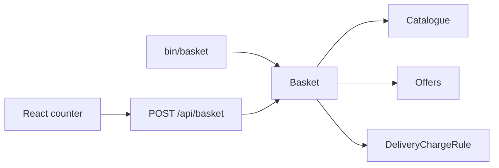

# Acme Widget Co. basket

A proof of concept for Acme's sales counter. The basket is priced in PHP. A small React screen sends it product codes and displays the quote it gets back.

## Catalogue

| Product | Code | Price |
| --- | --- | --- |
| Red Widget | R01 | $32.95 |
| Green Widget | G01 | $24.95 |
| Blue Widget | B01 | $7.95 |

Delivery is charged on the goods total **after** offers:

| Goods total | Delivery |
| --- | --- |
| Under $50 | $4.95 |
| $50 up to, but not including, $90 | $2.95 |
| $90 and over | Free |

The current offer is **buy one red widget, get the second half price**. Widgets are paired, so three red widgets discount one of them, and four discount two. The half-cent on $32.95 is dropped: the second widget is charged $16.47, which is a $16.48 discount. That is what makes the sample baskets land on $54.37 and $98.27.

## Run the tests

PHP 8.2 or newer, with the `mbstring`, `xml`, and `dom` extensions. [Composer](https://getcomposer.org/) installs the test runner.

```bash
composer install
composer test
```

## Price a basket from the terminal

```bash
php bin/basket B01 G01
php bin/basket R01 R01
php bin/basket R01 G01
php bin/basket B01 B01 R01 R01 R01
```

```text
Red Widget (R01) x 2                               $65.90
Subtotal                                           $65.90
Buy one red widget, get the second half price
Discount                                          -$16.48
Delivery                                            $4.95
Total                                              $54.37
```

`R01, R01` is the case that shows the two rules working together. The goods fall from $65.90 to $49.42, which is under $50, so delivery is $4.95 rather than $2.95.

## Run the counter

In one terminal:

```bash
composer serve
```

In another:

```bash
cd frontend
npm install
npm run dev
```

Open http://127.0.0.1:5173 (Vite prints another port if 5173 is already taken). The dev server proxies `/api` to the PHP server on port 8080. The page keeps the chosen codes in `localStorage`; refreshing does not empty the basket. PHP does not keep a session. Each quote is a fresh basket.

## How it is put together

`AcmeWidgetCo` is the composition root, and the only place that knows the prices, the delivery thresholds, and which offer is switched on. `Basket` is given three collaborators:

- a `Catalogue`, so a new product is data rather than a code change
- a `DeliveryChargeRule`, currently a `TieredDeliveryRule` built from a list of bands
- an `Offers` collection of `Offer` strategies

A second offer is a new class plus one line in `AcmeWidgetCo`. A different delivery policy implements `DeliveryChargeRule` and is passed into the basket. The tests include both substitutions.



Money is an integer number of cents. `total()` returns that value, and `format()` turns it into `$54.37` at the edge. The same pricing path feeds `summary()`, the CLI, and the JSON quote, so the screen cannot drift from the tests.

`POST /api/basket` with `{"items":["R01","R01"]}` returns the lines, the discount, the delivery, and the total. `GET /api/catalogue` returns the products, the offer copy, and the delivery bands the counter renders.

## Two red widgets, in cents

| Step | Cents |
| --- | --- |
| Two red widgets | 3295 + 3295 = 6590 |
| Second widget charged at `intdiv(3295, 2)` | 1647 |
| Discount | 1648 |
| Goods after the offer | 4942 |
| 4942 is under 5000, so delivery | 495 |
| Total | 5437, which is $54.37 |

The five-item basket is 11475 − 1648 = 9827. That is $90 or more, so delivery is free and the total is $98.27.

## Assumptions

- The currency is US dollars.
- "Under $50" and "under $90" are exclusive. Exactly $50 pays $2.95. Exactly $90 is free.
- Delivery is based on what the customer pays for the goods, after offers. An offer can move an order into a cheaper band.
- An empty basket is not an order, so it totals $0. A non-empty basket whose goods discount to $0 still pays the under-$50 delivery.
- When the same code has been added at more than one price, the cheaper widget in each pair is the half-price one. Acme's catalogue has one price per code, so the sample baskets do not depend on this.
- Offers are summed. If they ever discount more than the goods, the basket refuses to price the order rather than going negative.
- Product codes are matched without case or surrounding spaces.
- The counter is a client. It does not reimplement the pricing rules. The "add $0.58 to bring delivery down" note is display copy, calculated from the goods total and the bands the API already returned.
